# API Daftar Produk (ExpressJS + Prisma)

Lanjutan tugas sebelumnya: data produk sekarang disimpan di database **SQLite** lewat **Prisma ORM** (bukan array lagi), dan endpoint sudah lengkap CRUD (GET, POST, PUT, DELETE).

## Struktur Proyek

```
api-produk/
├── package.json
├── .env.example                       # contoh DATABASE_URL
├── prisma/
│   ├── schema.prisma                  # model Product
│   ├── seed.js                        # data awal (Buku, Pulpen)
│   └── migrations/                    # dibuat otomatis oleh prisma migrate
└── src/
    ├── app.js                         # entry point, setup Express, error handler
    ├── lib/prisma.js                  # instance PrismaClient
    ├── routes/productRoutes.js        # definisi URL -> fungsi controller
    └── controllers/productController.js  # logika tiap endpoint (query Prisma)
```

## Model Database

```prisma
model Product {
  id        Int      @id @default(autoincrement())
  name      String
  price     Int
  createdAt DateTime @default(now())
  updatedAt DateTime @updatedAt
}
```

## Cara Menjalankan

```bash
npm install
cp .env.example .env              # Windows PowerShell: copy .env.example .env
npx prisma migrate dev --name init   # buat tabel Product (otomatis menjalankan seed)
npm start
```

Server berjalan di `http://localhost:3000`.
Lihat isi database: `npx prisma studio` (buka `http://localhost:5555`).
Reset data ke awal: `npx prisma db seed`.

## Daftar Endpoint

| Method | Endpoint        | Body (JSON)                                | Response |
|--------|-----------------|--------------------------------------------|----------|
| GET    | /products       | -                                          | 200 + array seluruh produk |
| GET    | /products/:id   | -                                          | 200 produk, 400 id tidak valid, 404 tidak ada |
| POST   | /products       | `{ "name": "...", "price": 0 }`            | 201 produk baru, 400 validasi gagal |
| PUT    | /products       | `{ "id": 1, "name": "...", "price": 0 }`   | 200 produk terupdate, 400 validasi gagal, 404 tidak ada |
| DELETE | /products/:id   | -                                          | 200 produk terhapus, 400 id tidak valid, 404 tidak ada |

> PUT juga bisa lewat `/products/:id` (id di URL) dengan body `{ "name", "price" }`.

Validasi: `name` wajib string tidak kosong, `price` wajib angka bulat >= 0, `id` wajib angka bulat positif. Body yang bukan JSON valid -> 400.

## Skenario Pengujian

| No | Skenario | Request | Expected |
|----|----------|---------|----------|
| 1 | GET semua produk | `GET /products` | 200 |
| 2 | GET by id (ada) | `GET /products/1` | 200 |
| 3 | GET by id (tidak ada) | `GET /products/999` | 404 |
| 4 | POST sukses | `POST /products` `{"name":"Penghapus","price":3000}` | 201 |
| 5 | POST validasi gagal | `POST /products` `{"name":"","price":"abc"}` | 400 |
| 6 | PUT sukses | `PUT /products` `{"id":1,"name":"Buku Tulis","price":17000}` | 200 |
| 7 | PUT tanpa id | `PUT /products` `{"name":"A","price":1}` | 400 |
| 8 | PUT id tidak ada | `PUT /products` `{"id":999,"name":"A","price":1}` | 404 |
| 9 | DELETE sukses | `DELETE /products/3` | 200 |
| 10 | DELETE id tidak ada | `DELETE /products/999` | 404 |

### Contoh curl (Windows)

```bash
curl.exe -i http://localhost:3000/products
curl.exe -i -X POST http://localhost:3000/products -H "Content-Type: application/json" -d "{\"name\":\"Penghapus\",\"price\":3000}"
curl.exe -i -X PUT http://localhost:3000/products -H "Content-Type: application/json" -d "{\"id\":1,\"name\":\"Buku Tulis\",\"price\":17000}"
curl.exe -i -X DELETE http://localhost:3000/products/3
```

## Evidence

### Tugas sebelumnya (array)
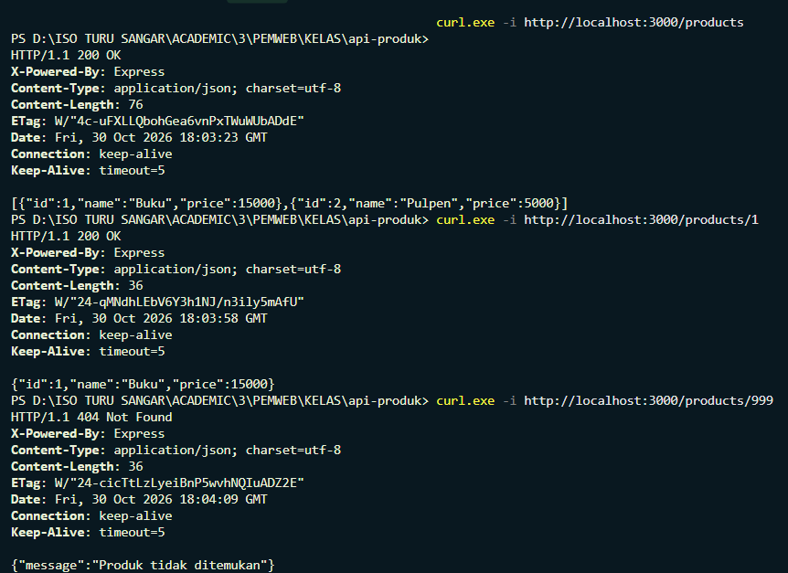
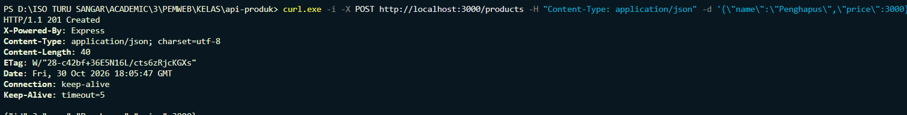

### Tugas Prisma — skenario (Postman)

**1. GET semua produk (200)**

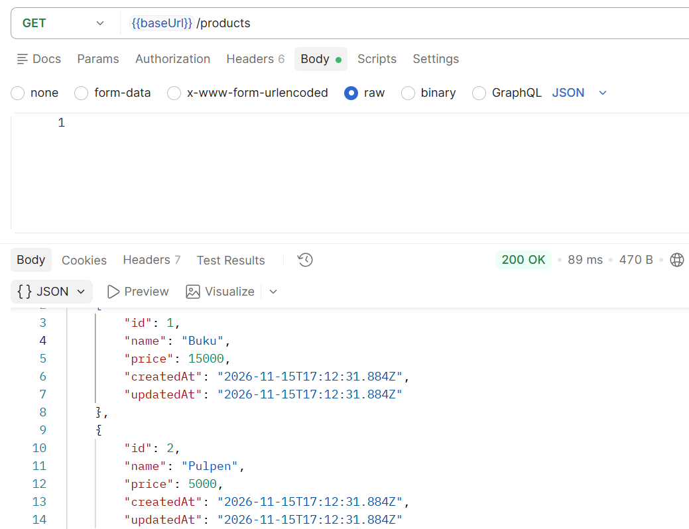

**2. GET by id - ada (200)**

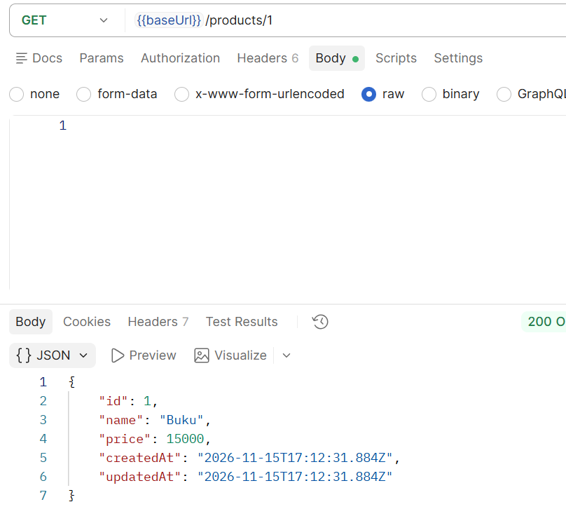

**3. GET by id - tidak ada (404)**

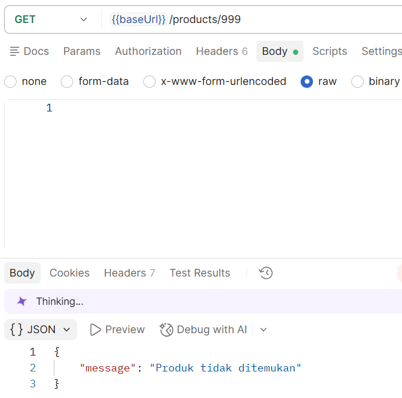

**4. POST sukses (201)**

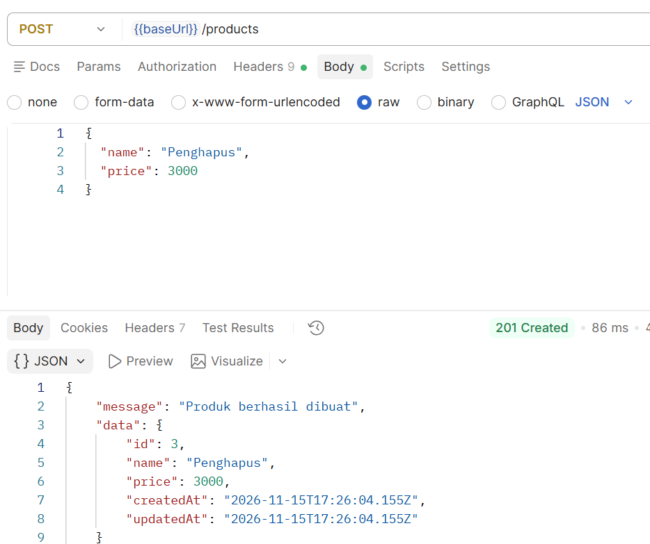

**5. POST validasi gagal (400)**

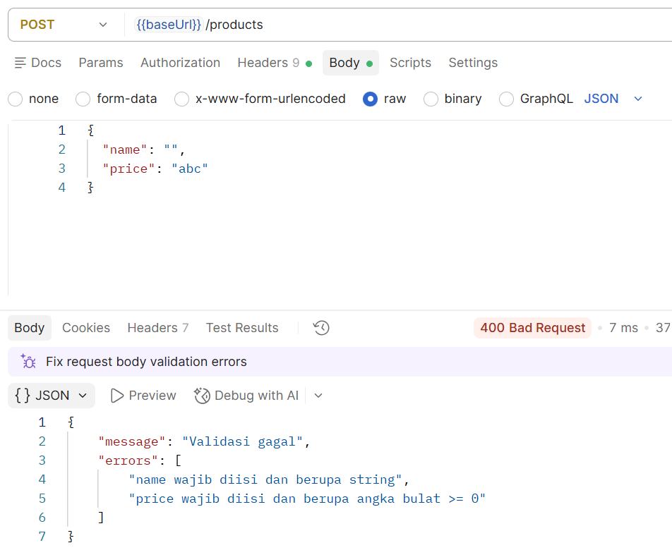

**6. PUT sukses (200)**

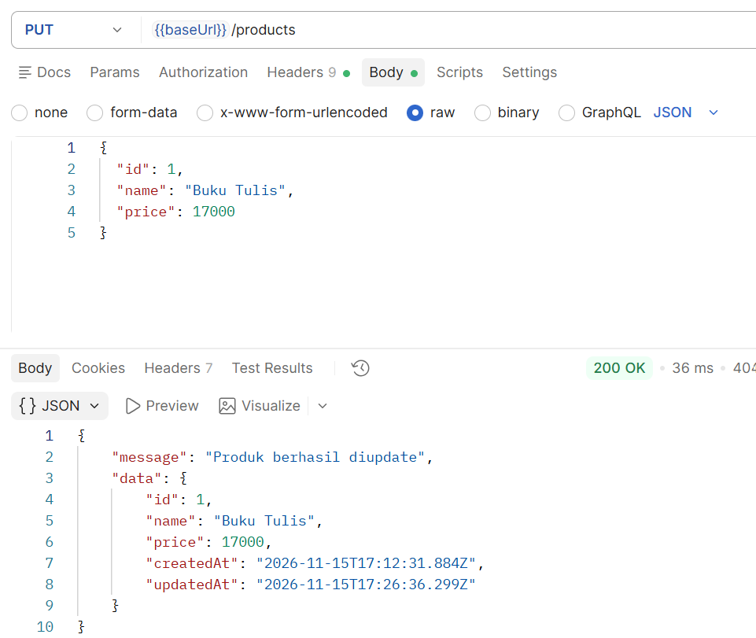

**7. PUT tanpa id (400)**

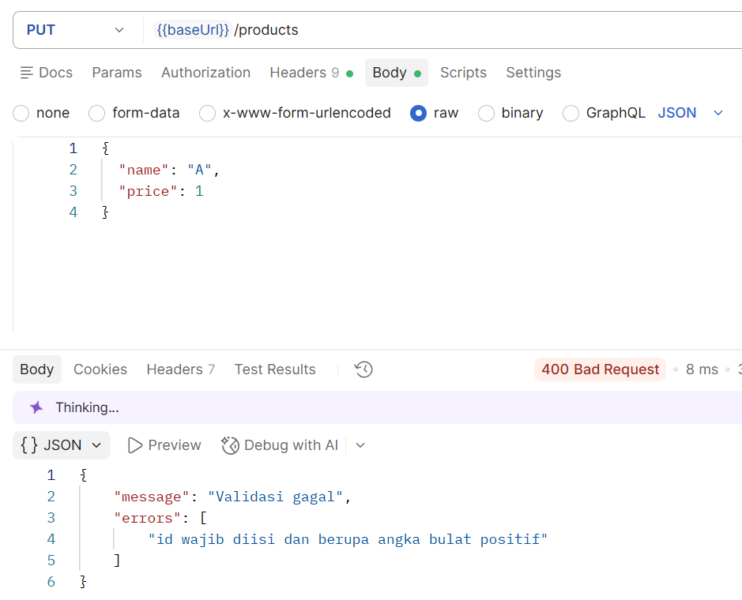

**8. PUT id tidak ada (404)**

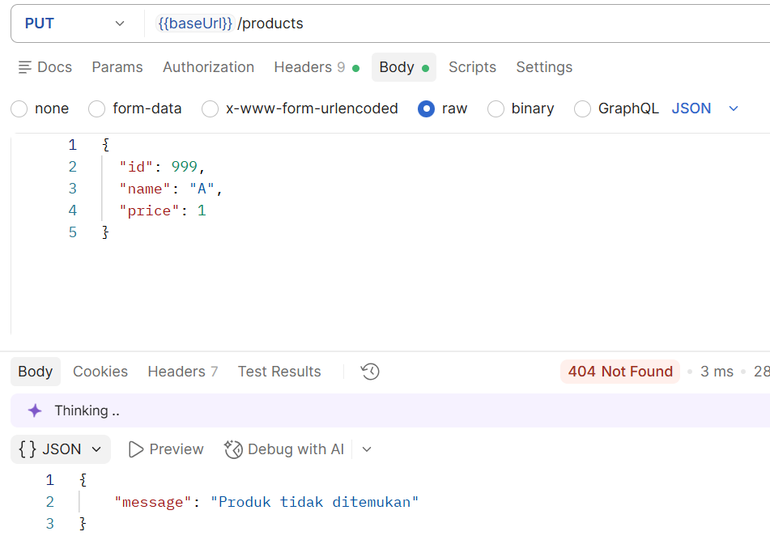

**9. DELETE sukses (200)**

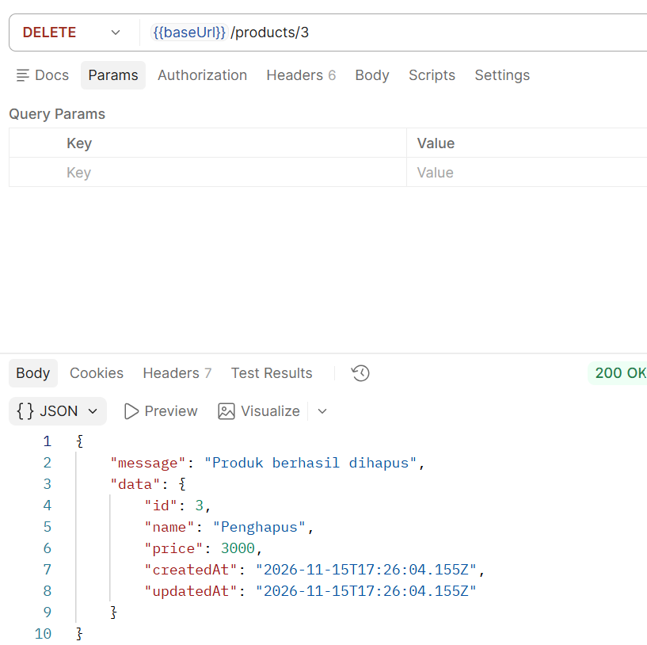

**10. DELETE id tidak ada (404)**

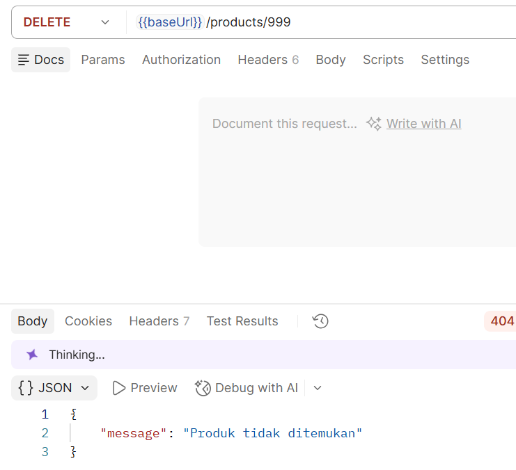

### Perubahan database (Prisma Studio, before - after)

Setiap "after" sekaligus menjadi "before" untuk operasi berikutnya.

**Kondisi awal (before POST)**

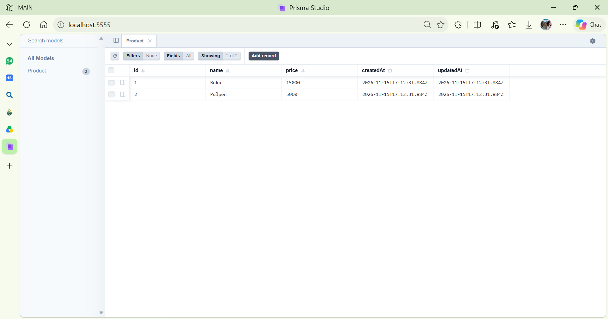

**Setelah POST — Penghapus (id 3) bertambah (after POST / before PUT)**

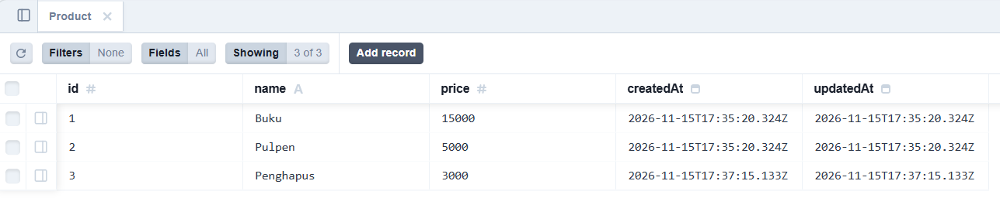

**Setelah PUT — id 1 jadi Buku Tulis, 17000 (after PUT / before DELETE)**

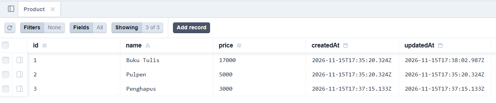

**Setelah DELETE — id 3 terhapus (after DELETE)**

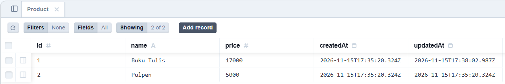
